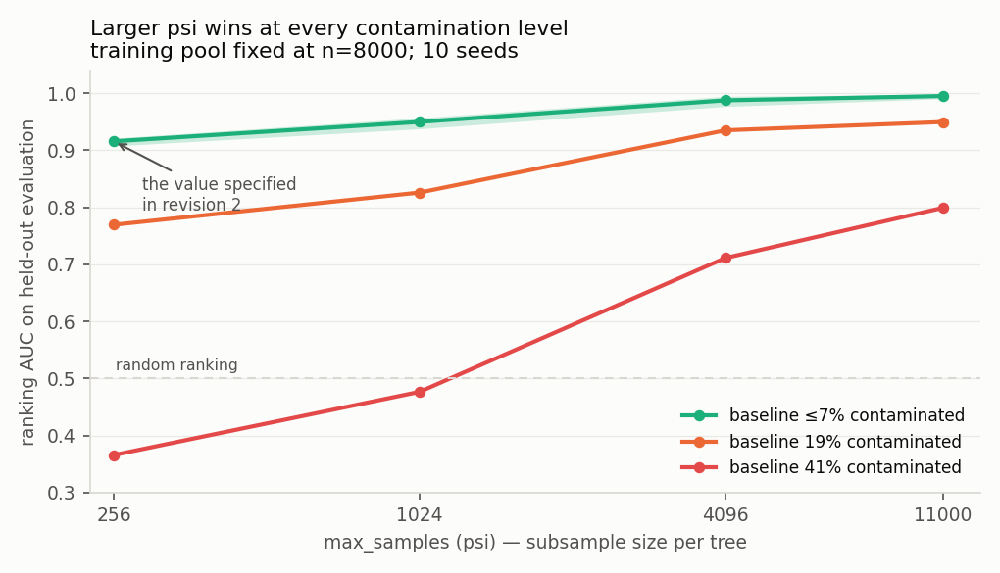
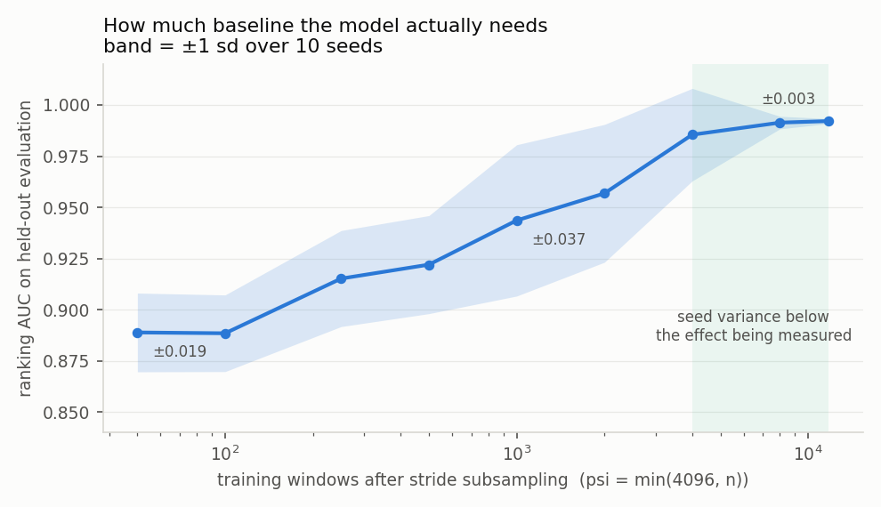
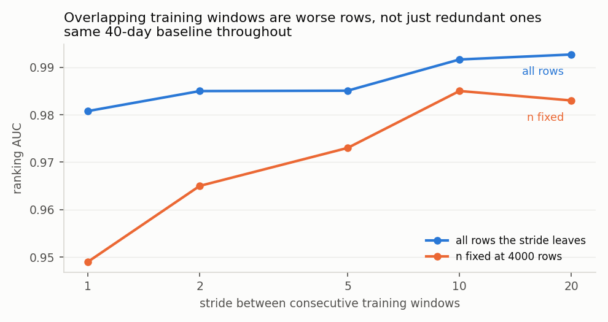
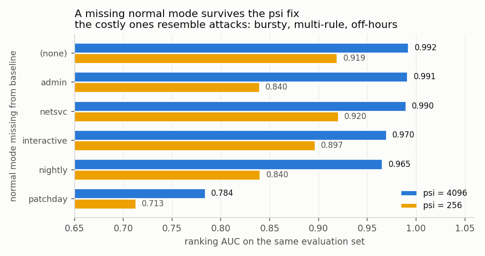
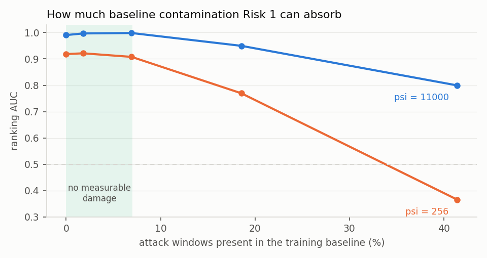
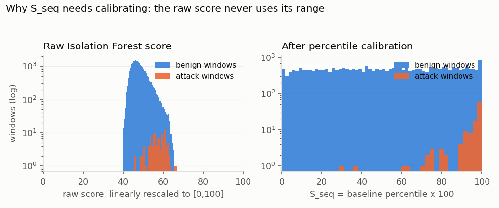
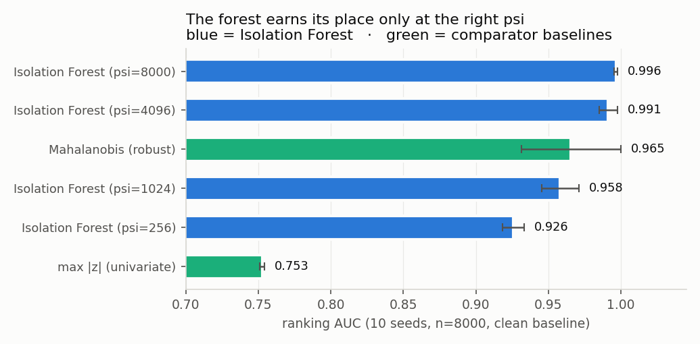

# Component 6: Data Requirements and Isolation Forest Specification

Working note for ContextAwareSIEM — prepared 2026-09-11
Supersedes Section 4.3 of `system_model.md` Revision 2

---

## 0. Summary, including a correction

This note answers four questions: what training data the anomaly model needs,
how much of it, what the lab hardware can support, and how Isolation Forest
actually works. It is backed by a simulation study (`tools/if_study.py`,
`tools/run_study.py`) rather than by argument alone, because the professor's
comment was that the component is underspecified and the honest fix is to
specify it from evidence.

**Correction to Revision 2.** Revision 2 specified `max_samples = 256`, justified
by the swamping/masking argument from the original Isolation Forest paper. That
was the paper's default applied without checking whether its precondition holds
here. It does not. Measured across every condition tested — clean baseline,
contaminated baseline, missing behaviour modes — **larger `max_samples` wins,
and at 256 the method loses to a trivial comparator it should beat.**

| Configuration | Ranking AUC (10 seeds) |
|---|---|
| Isolation Forest, ψ = n (8000) | **0.996 ± 0.001** |
| Isolation Forest, ψ = 4096 | 0.991 ± 0.006 |
| Mahalanobis, robust covariance *(comparator)* | 0.965 ± 0.034 |
| Isolation Forest, ψ = 1024 | 0.958 ± 0.013 |
| **Isolation Forest, ψ = 256** *(Revision 2's value)* | **0.926 ± 0.007** |
| max abs z-score, univariate *(comparator)* | 0.753 ± 0.002 |

Had the project been built on Revision 2's specification, the sanity comparator
added in Section 4.3.6 would have beaten the machine-learning method, and the
conclusion would have been that Isolation Forest does not earn its place. That
conclusion would have been an artefact of one hyperparameter.

**Revised value: ψ = 4096**, tuned on Session A over {256, 1024, 4096, n}.
Reasoning in Section 3.1.

**The other four findings:**

1. **Volume** — the model needs roughly **4,000–8,000 training windows after
   stride subsampling**. Below ~2,000 the seed-to-seed standard deviation is
   ±0.03–0.04 AUC, which is larger than the B2−B1 difference the project exists
   to measure. Above ~8,000 it is ±0.003. The binding requirement is not the mean,
   it is the variance.
2. **Stride subsampling measurably improves the model**, it is not merely
   housekeeping. Training on every overlapping window scores 0.981; striding to
   every 20th window scores 0.993 — using 5% of the rows.
3. **A missing normal behaviour mode costs more than any hyperparameter**, and
   survives the ψ fix. Omitting one periodic bursty mode from the baseline drops
   AUC from 0.992 to 0.784.
4. **Baseline contamination is far more survivable than assumed.** Up to ~7% of
   training windows being attack windows produced no measurable damage. Damage
   appears near 19%; at 41% the ranking inverts.

**Hardware is a non-issue.** Fitting at ψ = 4096 on 50,000 rows takes 0.6 s on
two cores. The constraint is entirely data collection.

---

## 1. What this study is, and what it is not

The project's real window vectors do not exist yet, so no study can predict
performance on them. What *can* be characterised are the method's responses to
the things the project controls: subsample size, baseline duration, window
overlap, baseline contamination, and behavioural coverage. Those are properties
of Isolation Forest and of the window construction, not of any particular alert
stream, so the *directions* transfer even though the absolute numbers will not.

The study generates a synthetic Wazuh-like alert stream with five normal
behaviour modes and injected attack chains, runs it through the **real** window
builder and the **real** feature map from Section 4.2.6 (`tools/window_builder.py`
— the same code a future implementation would use), and fits the model on the
resulting vectors.

**Read every absolute number as optimistic.** Synthetic attack chains are more
separable than real intrusions, so AUCs near 0.99 will not survive contact with
real data. The comparisons between configurations are the transferable part.

---

## 2. Isolation Forest, for someone who knows ML

Worth reading properly, because the method is unusual in ways that matter to
this design.

### 2.1 The mechanism

Most anomaly detectors build a model of normality and measure distance from it.
Isolation Forest does the opposite: it measures **how easily a point can be
separated from everything else by random splits.**

Build `t` trees. For each tree:

1. Draw a subsample of ψ points **without replacement** from the training set.
2. Recursively: pick a feature uniformly at random; pick a split value uniformly
   at random between the min and max of that feature **within the current node**;
   split.
3. Stop at one point per leaf, or at height limit `ceil(log2 ψ)`.

For a point `x`, `h(x)` is its path length to isolation, averaged over trees.
Anomalies sit in sparse regions, so a random cut separates them early — short
path. Normal points sit in dense regions and need many cuts — long path.

Normalise by the expected path length of an unsuccessful search in a binary
search tree of ψ nodes:

```
c(ψ) = 2·H(ψ−1) − 2(ψ−1)/ψ          H = harmonic number
s(x, ψ) = 2^( −E[h(x)] / c(ψ) )
```

`s → 1` means anomalous, `s → 0.5` means unremarkable, `s → 0` means deeply
interior to the normal region.

Three consequences of the construction:

- **No distance metric, no density estimate, no distributional assumption.** It
  never computes a neighbour or a covariance.
- **Training is sublinear in n** — each tree only ever sees ψ points, so once
  ψ is fixed, adding training rows costs nothing at fit time.
- **It is inherently randomised.** Two fits with different seeds give different
  scores. This is why the specification reports results over 10 seeds.

### 2.2 What it cannot see

These matter for the 15-feature window vector specifically.

**It is blind to correlation between features.** Splits are axis-parallel, so a
window that is anomalous only in the *joint* distribution — say a large
`window_size` together with a low `burst_ratio`, each unremarkable alone — is
not isolated any faster than a normal point. This is a real gap for this feature
set, where several features are strongly dependent by construction
(`window_size`, `burst_ratio`, `inter_arrival_mean_s` are three views of the
same arrival process). Extended Isolation Forest addresses it with oblique
splits; the study's Mahalanobis comparator also sees correlation, which is part
of why it performs as well as it does.

**Irrelevant features dilute it.** Each split picks a feature uniformly at
random. With 15 features of which perhaps 5 carry signal, two thirds of splits
are wasted. This interacts directly with the MITRE-coverage problem: if features
8–10 are mostly zero because Wazuh rules lack MITRE mappings, they are not
merely uninformative, they actively consume split budget. Dropping them is
therefore a performance improvement, not just a simplification.

**Binary features are disproportionately powerful.** A uniform split on
`novel_rule_flag ∈ {0,1}` always separates the two classes in one cut. If the
flag is rare, every window carrying it is isolated almost immediately. This is
probably desirable, but it means the flag behaves more like a rule than a
feature, and its influence should be checked in the attribution output.

**Heavy tails distort split placement.** Split values are drawn uniformly in
`[min, max]` *of the node*. One extreme value stretches that interval, so most
random cuts land in empty space and the dense region gets starved of splits.
This is why `window_duration_s`, `inter_arrival_mean_s` and `inter_arrival_min_s`
are `log1p`-transformed. Standardisation is not needed and would not help —
axis-parallel splits are invariant to monotone rescaling once the tails are
handled.

### 2.3 Implementation traps

Worth writing down, because each is a silent failure rather than an error.

| Trap | Detail |
|---|---|
| **Sign convention** | `sklearn`'s `score_samples` returns the **negative** of the published anomaly score. Higher = more normal. Negate it. Getting this backwards produces a model that ranks perfectly in reverse and an AUC near 0 — which looks like a broken pipeline, not a sign error |
| `contamination` | Sets a decision *threshold* only (`offset_`). This design ranks, it does not threshold. Leave it at `'auto'` and consume `score_samples` directly; setting it imports an unjustified prior about the attack rate |
| `decision_function` vs `score_samples` | The former is the latter minus `offset_`. For ranking they are equivalent; for reporting they are not. Use one consistently |
| `max_samples` int vs float | An int is an absolute count, a float is a fraction of n. `max_samples=256` and `max_samples=0.256` are very different |
| Feature order | The model has no column names. A feature map that reorders between fit and score fails silently with plausible-looking output. Bind the order to `FEATURE_NAMES` and assert it |
| Determinism | No `random_state` means unreproducible results between runs |

---

## 3. What the study measured

### 3.1 Subsample size ψ — the correction



At a fixed training pool of n = 8000, AUC rises monotonically with ψ, from 0.918
at ψ = 256 to 0.991 at ψ = n. The ordering holds at every contamination level
tested.

**Why the textbook argument did not apply.** The case for small ψ is resistance
to *swamping* (normal points near an anomaly cluster get flagged) and *masking*
(a dense cluster of anomalies stops looking anomalous because it is no longer
"few and different"). Both require anomalies to form a **dense cluster in feature
space**. In this setting they do not: attack chains are scattered across hosts
and time, so they appear as a diffuse minority. Estimating the proportion of a
diffuse minority is a job that *more* samples do better, not worse.

The hypothesis that contamination would reverse this was tested directly and
refuted — see 3.5.

**Recommendation: ψ = 4096.** Not ψ = n, despite ψ = n scoring marginally higher
(0.996 vs 0.991), because the model size grows with ψ: at ψ = 4096 the pickled
forest is 13.7 MB and fits in 0.6 s; at ψ = 50,000 it is 75 MB and 2.5 s. The
difference in AUC is within twice the seed standard deviation and does not
justify a 5× model. Treat ψ as tuned on Session A over {256, 1024, 4096, n} and
report the curve — that is what makes it specified rather than asserted.

### 3.2 How much data



With ψ = min(4096, n):

| Training windows | AUC | seed sd |
|---|---|---|
| 50 | 0.889 | ±0.019 |
| 250 | 0.915 | ±0.023 |
| 1,000 | 0.944 | ±0.037 |
| 2,000 | 0.957 | ±0.034 |
| 4,000 | 0.985 | ±0.023 |
| 8,000 | 0.991 | ±0.003 |
| 11,733 | 0.992 | ±0.001 |

**The variance is the requirement, not the mean.** At n = 1,000 the method
already reaches AUC 0.944 — respectable — but the seed standard deviation is
±0.037. The B2 vs B1 comparison is the measurement the project exists to make,
and if its effect size is comparable to ±0.04 then re-seeding the model would
change the answer. At n = 8,000 the standard deviation is ±0.003 and a real
difference becomes visible.

**Target: 8,000 training windows after stride subsampling; 4,000 as the floor.**

Translating to collection effort, at stride 10 and roughly 1.2 windows per
admitted alert:

| Baseline duration | Admitted alerts/day needed for 8,000 windows |
|---|---|
| 14 days | ~4,800 |
| 30 days | ~2,200 |
| 60 days | ~1,100 |
| 90 days | ~740 |

For reference, the recorded 2026-09-05 sample produced roughly 2,750 admitted
alerts/day — but that was installation activity on a fresh machine, not steady
state. **Measuring the steady-state admitted rate is the single most important
thing to do this week** (Section 7).

### 3.3 Window overlap and stride



Revision 2 justified stride subsampling as a correction to effective sample size.
The measurement shows it is stronger than that — striding *improves* the model,
under both readings:

- **At fixed n = 4,000 rows:** stride 1 gives 0.949, stride 10 gives 0.985.
  Overlapping rows are genuinely worse rows, because 4,000 consecutive windows
  span far less real time than 4,000 windows drawn every tenth alert.
- **Using all rows from the same 40-day baseline:** stride 1 (117,329 rows) gives
  0.981; stride 20 (5,867 rows) gives 0.993. Discarding 95% of the training data
  made the model better.

The reason is coverage rather than statistics. With every overlapping window
included, the training distribution is dominated by whichever entity and period
emitted the most alerts. Striding de-duplicates that and gives quieter periods
proportionate weight.

**Recommendation: stride 10, with 20 checked during tuning.** And a practical
consequence worth noting: the model needs far fewer *rows* than the baseline
produces, so the storage and compute cost of the anomaly model is negligible
compared with the cost of collecting the alerts in the first place.

### 3.4 Behavioural coverage — the real constraint



Each bar is the same model and evaluation set, with one normal behaviour mode
removed from the baseline period.

| Mode withheld | AUC (ψ=4096) | vs. full coverage |
|---|---|---|
| *(none — full coverage)* | 0.992 | — |
| `admin` (occasional package/service changes) | 0.991 | −0.001 |
| `netsvc` (sporadic port changes) | 0.990 | −0.002 |
| `interactive` (logon/logoff, business hours) | 0.970 | −0.022 |
| `nightly` (scheduled batch burst, 01:00–04:00) | 0.965 | −0.027 |
| `patchday` (weekly bulk update burst) | **0.784** | **−0.208** |

The cost is not uniform, and the pattern is informative: **the expensive modes to
miss are the ones that structurally resemble an attack.** `patchday` is a burst
of many alerts from several rules in a short window, outside the usual rhythm —
which is exactly the signature the model is being built to flag. A baseline that
never saw one will rank every future patch burst at the top of the queue.

This is the finding that should drive the collection plan. It means baseline
adequacy is a question of **calendar coverage**, not row count: the baseline must
span at least one full cycle of whatever periodic bulk activity the environment
has — Patch Tuesday, weekly backups, scheduled scans, weekend idle. A two-week
baseline that misses a monthly job is not fixed by collecting more alerts inside
those two weeks.

*Caveat:* withholding `patchday` also shrinks the training pool (2,699 vs 7,038
rows), so mode identity and volume are partly confounded for that row.
Withholding `admin` leaves a comparable pool (7,170) and costs nothing, and
`nightly` leaves a smaller pool (5,073) and costs only 0.027, so pool size does
not explain the pattern — but the magnitude for `patchday` is an upper estimate.

### 3.5 Baseline contamination — Risk 1 has more headroom than assumed



Attack windows were injected into the *training* baseline at increasing rates:

| Attack windows in training | AUC at ψ=4096 | AUC at ψ=256 |
|---|---|---|
| 0% | 0.977 | 0.918 |
| 1.8% | 0.991 | 0.921 |
| 6.9% | 0.995 | 0.908 |
| 18.6% | 0.935 | 0.769 |
| 41.4% | 0.711 | 0.366 |

Two results:

- **Up to roughly 7% contamination produced no measurable damage.** Risk 1 in
  Section 6.2 is real but the tolerance is wide. Given that an emulation session
  produces on the order of tens of attack alerts against a baseline of tens of
  thousands, an accidental overlap would have to be gross to matter.
- **Large ψ is *more* robust to contamination, not less** — the opposite of the
  masking argument. At 41% contamination, ψ = 256 scores 0.366, which is worse
  than random: with 256 subsample points and 41% of them attacks, the attacks
  become a legitimate mode of the subsample and the model learns them as normal.
  More samples estimate the mixture proportion better.

This does not make the Risk 1 controls unnecessary — a 41% figure shows the
failure is catastrophic once it arrives — but it does mean the manual inspection
of top-scoring baseline windows is a check on a wide margin rather than a
knife-edge.

### 3.6 Score calibration — confirmed



Measured on the evaluation set: raw Isolation Forest scores span **0.400 to
0.669**, mean 0.483, sd 0.040. Linearly rescaled to `[0,100]` that is a span of
26.9 points, with essentially all mass between 45 and 52.

`w_s · S_seq` would therefore have been near-constant across alerts regardless of
`w_s`, and the B2-vs-B1 comparison would have measured close to nothing for
reasons unrelated to temporal context. After percentile calibration the standard
deviation is 29.0 rather than 4.0, and `S_seq` is uniform on `[0,100]` over
baseline data by construction.

The calibration specification from Revision 2 stands unchanged:

```
S_seq = 100 · F̂_baseline( s(φ(W)) )
```

### 3.7 Does the forest earn its place



Yes — at ψ = 4096 or above, and not at ψ = 256. The two comparators bracket it
usefully:

- **max abs z-score (0.753)** is the univariate floor: it asks whether any single
  feature is extreme. Isolation Forest beats it comfortably at every ψ tested,
  which establishes that the multivariate structure carries real signal.
- **Robust Mahalanobis (0.965 ± 0.034)** is the multivariate-linear floor. It
  beats Isolation Forest at ψ ≤ 1024 and loses at ψ ≥ 4096. Its seed variance is
  five times higher, which is its own argument against it.

Both should be reported as ablation arms (B2′ and B2″). The Mahalanobis arm in
particular is worth keeping precisely because it is competitive: a reviewer will
ask why a tree ensemble rather than a covariance model, and "we measured it" is
the only good answer.

---

## 4. What data would be ideal

### 4.1 Required properties

Derived from the study rather than asserted:

| Property | Why | Evidence |
|---|---|---|
| **Spans a full activity cycle** — at minimum one week, preferably one month covering a patch cycle | A missing periodic bulk mode is the largest single degradation measured | 3.4 |
| **Behavioural, not scan output** | Compliance alerts carry mitigation-oriented MITRE fields, and their bulk defeats the escalation gate | §4.2.3, `FEEDBACK_RESPONSE.md` D.3 |
| **Same generating process as evaluation** — same hosts, same ruleset version, same `ossec.conf` | The calibration table and the model are both fitted to a distribution; changing agent config between baseline and evaluation shifts it silently | design |
| **≥ 8,000 windows after stride 10** ≈ 65,000 admitted alerts | Below this, seed variance exceeds the effect being measured | 3.2 |
| **Multi-entity** — user and source IP actually resolving | Per-entity-type models cannot be fitted for a type that never resolves | §4.1.3 |
| **Clean, but not obsessively** — under ~7% attack contamination | Wide tolerance measured | 3.5 |

### 4.2 What the current lab does not provide

Five gaps, in order of severity:

**1. The captured data is from the wrong host.** `wazuh_dataset.json` is agent
`000` — the Wazuh manager itself, on WSL2 Ubuntu. The deployment view in Section 7
of the system model says the telemetry source is the Windows 11 host with Sysmon.
No Sysmon data has been captured at all. Every volume and coverage estimate in
this note is therefore about a stream that has not yet been observed.

> **Cause identified 2026-09-11, and it is not a configuration fault.** The
> Windows agent's log lists all four channels — `Application`, `Security`,
> `System` and `Microsoft-Windows-Sysmon/Operational` — so Sysmon has been
> forwarded correctly the whole time. The reason no Sysmon telemetry appeared is
> simply that the sample was exported from agent `000` rather than the Windows
> agent. Nothing to fix; the gap closes as soon as the first corpus is assembled
> from the right agent. Gaps 2 and 3 below still stand.

**2. Alert volume is thin by design, not by accident.** Wazuh writes only rules
at level ≥ 3 to `alerts.json` (`log_alert_level`, default 3), and most Sysmon
rules that match ordinary process creation sit at level 0 precisely so they do
not flood. The behavioural alert stream is therefore quiet by default. This is
the root cause of the volume problem — it is not that the lab is idle, it is
that Wazuh is filtering.

**3. Only one entity type resolves.** Host resolves for 300/300 alerts, user for
9/300, source IP for 0/300. Per-entity-type models are currently unfittable for
two of the three types.

**4. A fresh install is not a baseline.** The recorded sample is dominated by
package installation and first-boot configuration assessment — activity that
occurs once and never recurs. It is close to the worst possible baseline: high
volume, zero representativeness.

**5. No periodic cycle has been observed.** Ten minutes cannot contain a weekly
pattern, and 3.4 says the weekly pattern is what matters most.

### 4.3 How to fix the volume problem

The lever is Windows audit policy, not Wazuh configuration. Windows does not
generate logon and process-creation events at all unless the advanced audit
policy is enabled; once it does, Wazuh's existing rules pick them up at level 3
and above and they land in `alerts.json` without any custom rules.

Suggested, in order of value:

1. **Enable Logon/Logoff auditing** (success and failure). Produces 4624/4625/4634
   events, which map to the Windows authentication rules at level 3 for success
   and level 5 for failure. This is the single highest-value change: it raises
   volume *and* makes the **user** entity resolve, and network logons make
   **source IP** resolve. It addresses gaps 2 and 3 together.
2. **Enable Process Creation auditing with command-line inclusion** (4688).
   High-volume, genuinely behavioural, and it is what the `process` and
   `parent_process` fields of the Section 4.1.2 schema were specified for.
3. **Confirm Sysmon is actually forwarding.** The Sysmon configuration determines
   what is emitted, and the Wazuh ruleset determines what is alerted on. Both
   need checking against the actual capture, not assumed.
4. **Only if the above is insufficient:** local rules re-raising selected Sysmon
   event IDs to level 3. This is a last resort because it makes the alert stream
   non-standard and weakens the claim that the layer works on a stock Wazuh
   deployment.

**Verify rather than trust the rule IDs above.** They come from documentation,
not from the lab. On the manager:

```bash
grep -rn "4624\|4625\|4688" /var/ossec/ruleset/rules/ | head -40
grep -c "<rule" /var/ossec/ruleset/rules/0580-win-security_rules.xml
```

and then confirm empirically by logging out and back in and watching
`alerts.json`. Five minutes of checking is worth more than any citation here.

---

## 5. Hardware

Not a constraint. Measured on two cores — weaker than the lab machine — with
15-dimensional data:

| Configuration | Fit | Score 20,000 windows | Model size |
|---|---|---|---|
| n = 5,000, ψ = 4096 | 0.41 s | 0.31 s | 13.6 MB |
| n = 50,000, ψ = 4096 | 0.63 s | 0.31 s | 13.7 MB |
| n = 50,000, ψ = n | 2.47 s | 0.44 s | 75.0 MB |

Fit time is near-constant in n because each tree only ever sees ψ points. The
full 10-seed protocol at ψ = 4096 costs under 10 seconds. The entire parameter
sweep in this note — six experiments, several hundred model fits — ran in a few
minutes.

The lab host is a Ryzen 7 3700X (8 cores / 16 threads), which is far more than
this needs. **Two real constraints, neither computational:**

- **Disk.** The volume reported for the project drive is 476 GB with roughly
  50 GB free (90% used). Continuous alert collection over 30–90 days, with the
  Wazuh Indexer retaining documents, will consume more than that. Set an index
  retention policy before starting collection, or plan to keep only the raw
  `alerts.json` and discard indexer storage — the prioritisation layer reads the
  former, so the latter is a dashboard convenience, not a dependency.
- **Continuity.** Collection must run unattended for weeks. WSL2 stops when the
  Windows host sleeps, which will punch gaps into the baseline and, worse, will
  correlate those gaps with time of day. That is a coverage problem of the kind
  Section 3.4 shows to be expensive. Check the power plan before starting.

---

## 6. Revised specification for Component 6

Replaces Section 4.3 of `system_model.md`. Changes against Revision 2 are marked.

**Model scope.** One forest per entity type, as before. Contingent on 4.2 gap 3
being fixed; if user and source IP still fail to resolve at a useful rate after
audit policy is enabled, fall back to a single model with entity type one-hot
encoded and report which was used.

**Training data.** Windows from the benign baseline, admitted per Section 4.2.3,
stride-subsampled at s = 10 *(changed: was justified as a correction, now
justified as an improvement — 3.3)*. Target 8,000 rows, floor 4,000.

**Preprocessing.** `log1p` on `window_duration_s`, `inter_arrival_mean_s`,
`inter_arrival_min_s`. No standardisation. Feature order bound to
`FEATURE_NAMES` and asserted at both fit and score time *(new — 2.3)*.

**Hyperparameters.**

| Parameter | Value | Change | Justification |
|---|---|---|---|
| `n_estimators` | 200 | — | Cross-seed variance stable; cost negligible |
| `max_samples` (ψ) | **4096** | **was 256** | Monotone improvement to ψ = n; 4096 captures nearly all of it at a fifth the model size (3.1) |
| `max_features` | 1.0 | — | |
| `contamination` | not used | — | Ranks, does not threshold |
| `random_state` | fixed, 10 seeds reported | — | ±0.003 at target n (3.2) |

ψ is tuned on Session A over {256, 1024, 4096, n} and the curve reported.

**Calibration.** `S_seq = 100 · F̂_baseline(s(φ(W)))`, table frozen with the
model. Confirmed necessary — 3.6.

**Attribution.** Leave-one-feature-out re-scoring against the baseline median.

**Cold start.** `window_size < 3` → unscored, `S_seq = 50`, flagged.

**Comparators, both reported.**

| Arm | Method | Tests |
|---|---|---|
| B2′ | max abs robust z-score | Whether multivariate structure matters at all |
| B2″ | Robust Mahalanobis (`MinCovDet`) | Whether tree structure beats a covariance model *(new — 3.7)* |

**Known limitations to state in the report** *(new — 2.2)*: axis-parallel splits
are blind to feature correlation; uninformative features consume split budget,
so sparse MITRE features are actively harmful rather than merely useless;
`novel_rule_flag` behaves more like a rule than a feature.

---

## 7. What to do this week

In priority order. The first three are measurements, not implementation.

1. **Measure the steady-state admitted alert rate.** Leave the current setup
   collecting for 72 hours with no installation activity, then run
   `tools/doublecount_check.py` over the result. The admitted-alert count divided
   by three is the number every estimate in Section 3.2 depends on. **This gates
   everything else** — if it comes back at 50/day, the design needs to change,
   not the parameters.
2. **Enable Windows Logon/Logoff and Process Creation auditing** and confirm the
   alerts appear. Re-measure the rate afterwards. Also record per-entity-type
   resolution rates — this is the test of whether the three-entity model survives.
3. **Get Sysmon telemetry into the capture at all.** Nothing collected so far is
   from the host the design targets.
4. **Set index retention and disable sleep** before starting the real baseline
   (Section 5).
5. **Run `tools/window_builder.py` over whatever is collected** and check which
   of the 15 features are actually populated and non-constant. A feature that is
   constant across the baseline contributes nothing but consumes split budget.
   Expect features 8–10 to be the casualties.

Implementation of the model itself is a day's work once the data exists. It is
not the risk.

---

## 8. Open questions

**8.1 — Should ψ be tuned per entity type?** Host windows will be far more
numerous than user windows, and the study only covers one regime. Probably yes,
but it adds a tuning dimension.

**8.2 — Is 90 days of baseline compatible with the schedule?** Section 3.4 argues
for calendar coverage of at least one patch cycle, and Section 3.2 wants ~8,000
windows. If the admitted rate comes back low, those two requirements conflict
with an implementation deadline in late November. The honest resolutions are a
shorter baseline with the coverage limitation stated in the results, or scripted
benign activity to raise the rate — which is itself a threat to validity and
would need declaring.

**8.3 — Does the Mahalanobis comparator belong in the report if it wins?** It
does not win at the corrected ψ, but it might on real data, which is less
Gaussian-friendly than the simulation. The recommendation stands: report it
either way. A project that measured the thing and reported it is stronger than
one that did not look.

---

## Files

| File | What it is |
|---|---|
| `tools/window_builder.py` | Reference implementation of Component 5's feature map. Runs on real Wazuh alerts and on simulated streams |
| `tools/if_study.py` | Stream generator, scorers, ranking metrics |
| `tools/run_study.py` | The six experiments; writes `results*.json` |
| `figures/component6/fig1..fig7` | The figures in this note |

Sources for the Wazuh configuration claims in Section 4:
[alerts — ossec.conf reference](https://documentation.wazuh.com/current/user-manual/reference/ossec-conf/alerts.html),
[Windows event rules](https://deepwiki.com/wazuh/wazuh-ruleset/2.3.1-windows-event-rules),
[wazuh-ruleset 0580-win-security_rules.xml](https://github.com/wazuh/wazuh-ruleset/blob/master/rules/0580-win-security_rules.xml).
